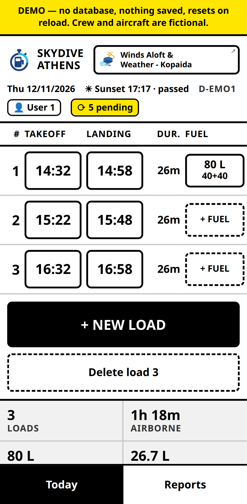
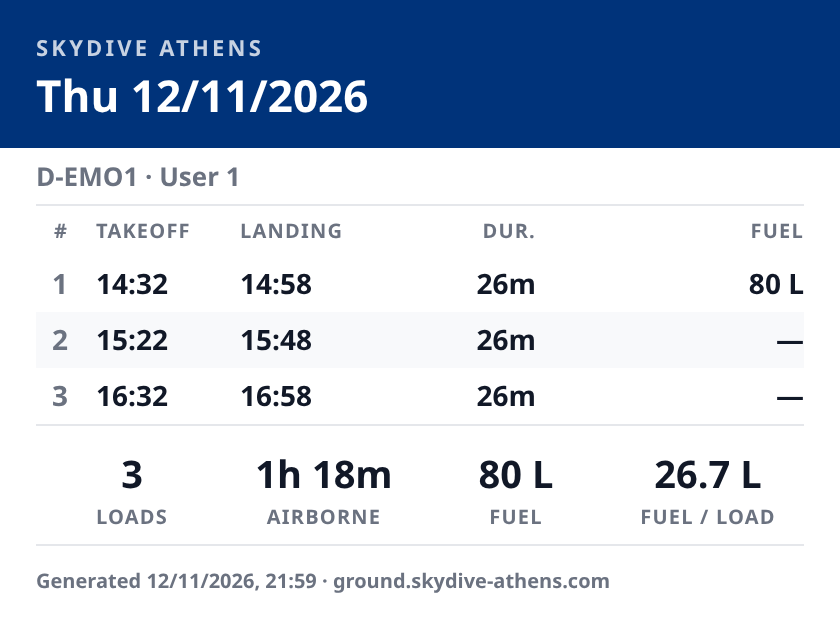
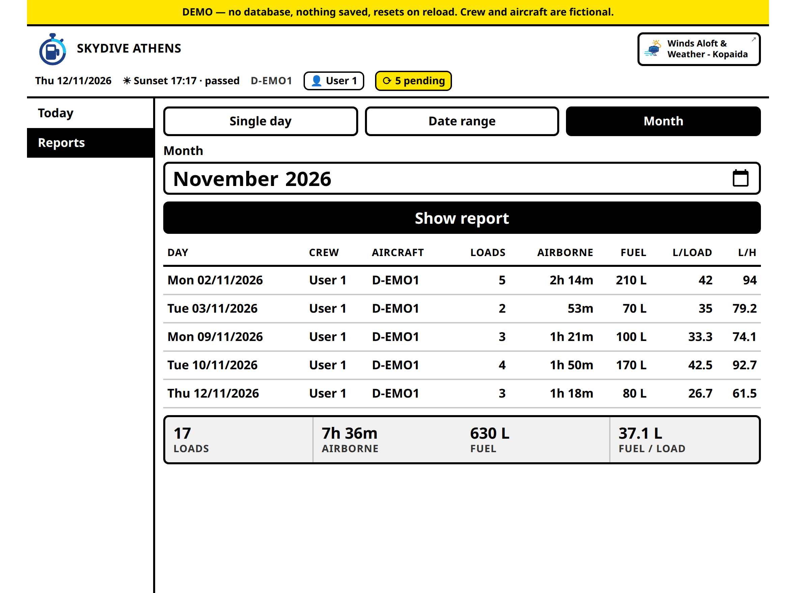
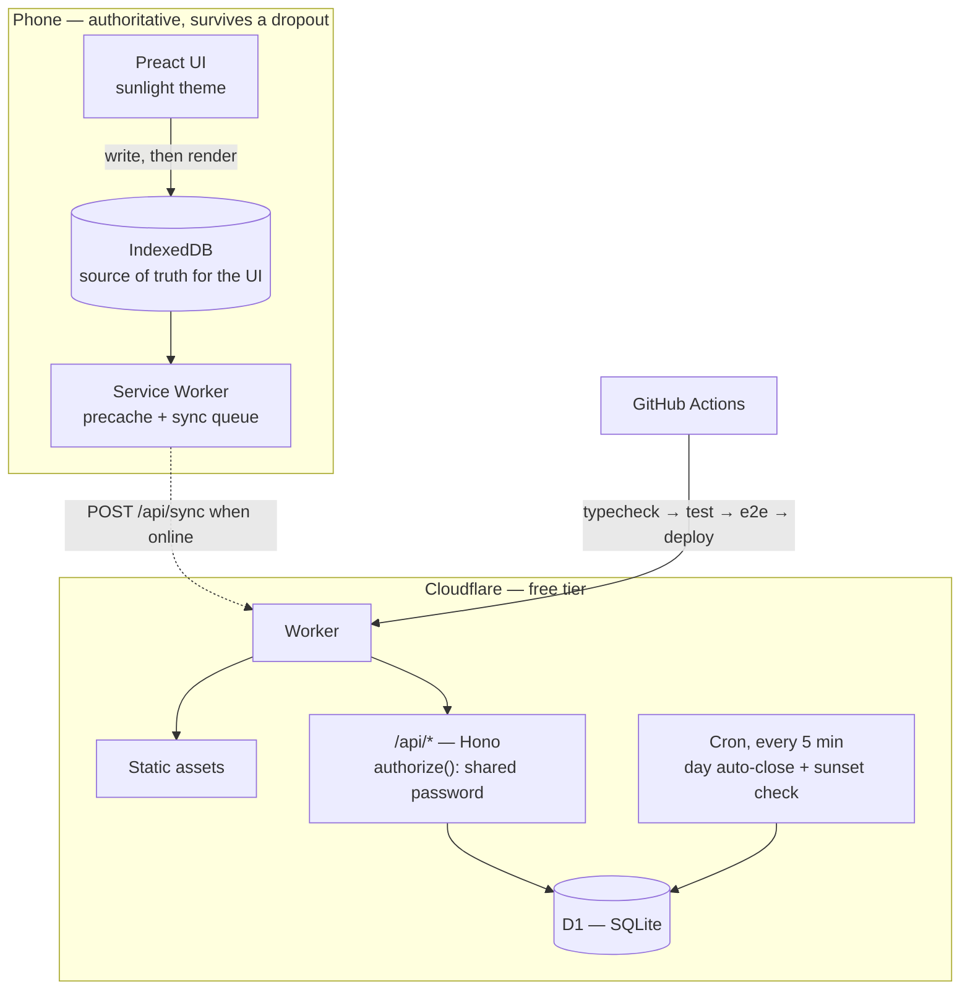

# Ground — a fuel and flight log for a dropzone

[](https://github.com/nikospavlopoulos/sd-ground-demo/actions/workflows/test.yml)

**A production web app that records every load a jump aircraft flies and every
litre of fuel that goes into it.** It runs on Cloudflare Workers, D1 and Preact,
and it is used on operating days at Skydive Athens, at Kopaida Dimitra airfield in
Boeotia, Greece.

**→ Try it: [ground-demo.skydive-athens.com](https://ground-demo.skydive-athens.com)**
— the real app with no database behind it. Nothing is saved, the crew and the
aircraft are fictional, and the airfield and its sunset are real.

The application's source is private. This repository holds a **runnable excerpt of
its domain core**, seven of its **decision records**, and the reasoning behind
both.

---

## What it looks like

| Today | The day, shared to a chat |
|---|---|
|  |  |

Above 700 px the report becomes a table, and the navigation becomes a sidebar:



Those figures are worth a second look. The month totals **630 L over 17 loads =
37.1 L per load** — not the mean of the five daily figures, which is 35.9. Every
ratio is recomputed from summed primitives, and there is a
[test](sample/test/totals.test.ts) that fails if anyone ever averages the averages.

---

## Why I built it

I am a licensed USPA skydiver and a certified skydiving coach, and I work ground
crew at the dropzone. I built this on my own initiative: I was the one logging the
loads, so I was the one watching the problem.

Flights and fuel lived in a phone note, in Greek, retyped from scratch every
operating day:

```
Καύσιμα (αριστερή_δεξαμενή + δεξιά_δεξαμενή (σύνολο λίτρα))
1) ** + ** (**)
…
Χρόνος (Α = Απογείωση & Π = Προσγείωση (σύνολο λεπτά))
1) A1 ** - Π1 ** (**)
```

Three things were wrong with it. Every total was mental arithmetic done between
loads, with the next lift already boarding. A note can be overwritten or lost, and
it keeps no history of either. And nothing in it was queryable — "how much fuel
per load did we average last month" had no answer short of reading every note.

## What it does

- **Fuel per tank per load** — left and right, because they are filled separately.
  Equal amounts save silently; unequal amounts ask once, since the tanks are
  normally filled to matching levels and a mismatch is usually a typo.
- **Wheels-up and wheels-down per load**, one tap each, correctable afterwards.
- **Totals derived, never stored**: loads, airborne time, litres, and average fuel
  per load.
- **Day, month and arbitrary date-range reports**, naming the crew member who held
  the shift and the aircraft.
- **Sunset and time remaining in the header**, computed from the airfield's
  coordinates — jumping stops at sunset.
- **Survives a dropout and starts from cache.** Installable to a home screen.
- **Shares a finished day as an image** to the phone's share sheet.

## Architecture



## Engineering highlights

**The client is authoritative — as hardening, not necessity.** Coverage at the
field is fine. But the crew move around the zone all day, and a takeoff time that
cannot be recorded at the moment of takeoff is a wrong takeoff time. A tap updates
the screen synchronously, persists to IndexedDB, and queues an operation; the
server catches up afterwards. *"Usually fine" is not good enough for the one tap
that matters* — [0003](decisions/0003-offline-first-with-client-uuids.md).

**Entities carry client-generated UUIDs**, so replaying a queue that partly landed
converges on the same rows instead of duplicating them. Day ids are derived from
the date, so two devices that each create the same day offline produce the *same*
row rather than colliding on a unique constraint.

**A sync batch degrades, it does not die.** A crew member's id was renamed by hand
to tidy the roster. The database came out perfectly consistent — and the id was
not a database-only value: a phone keeps its own copy and stamps it on everything
it queues. Every queued operation then failed a foreign key, D1's batch is one
transaction so the good entries rolled back with the bad one, and the client keeps
its queue on any error. **One phone could not sync for ten days, and the header
showed exactly what a phone with no reception shows.** Nothing was lost. The fix
was per-entry degradation, a distinct "not syncing" state, and an error handler —
[0022](decisions/0022-a-sync-batch-must-degrade-not-die.md).

**Totals are derived on read, never stored** — so moving the dropzone to another
airfield would recompute every historical day correctly, sunset included. A stored
total is a second source of truth that disagrees with the first after the first
edit — [0016](decisions/0016-a-day-is-what-its-loads-say-it-is.md).

**Times are local wall-clock strings, never UTC instants.** "Wheels up at 09:42" is
a fact about the airfield's clock; convert it and a daylight-saving changeover
silently rewrites history. The sibling winds app stores true instants, for exactly
the opposite and equally correct reason — [0019](decisions/0019-linking-to-the-winds-app.md).

**The interface is designed for sunlight first.** Forced light with contrast far
past the WCAG AAA floor, because outdoors the screen competes with the sun and
dark mode washes out to grey. Control size keys off `pointer: fine` rather than
viewport width, so a tablet keeps full-size targets —
[0010](decisions/0010-forced-light-theme-for-sunlight.md).

**Name folding, because Greek transliterates inconsistently.** `Theodorou`,
`Theodoroy` and `theodorou` are one person typed three ways, and without folding
they become three crew members. [`normalize.ts`](sample/src/normalize.ts) collapses
the digraphs and vowel clusters that carry no information, then uses edit distance
to offer the existing person rather than silently creating another.

**Validation comes from practice, not first principles.** A real day recorded two
loads at `13:19 → 13:19` — somebody had caught up on a forgotten log by tapping.
The app now warns on the implausible and refuses only a self-contradiction, and
**refuses it on the phone**: the server returns a refused entry to the client,
which drops it permanently, so validating there would delete a real load instead of
correcting it — [0023](decisions/0023-warn-on-implausible-times-refuse-only-a-contradiction.md).

**The public demo has no Worker and no database binding at all** — not a Worker
that declines to use one. Demo mode is resolved at build time, so the production
bundle cannot contain it, and CI greps the built JavaScript to prove it. That grep
failed the first two times it ran, on code at a module's top level rather than
inside a branch: tree shaking removes unreachable code, not executed code —
[0025](decisions/0025-a-separate-origin-for-the-public-demo.md).

## The sample

[`sample/`](sample) holds six modules and their tests, lifted unchanged except for
import paths. Clone and run them:

```bash
cd sample
npm ci
npm run typecheck
npm test
```

They are the pure part of the application — no Worker, no client, no database, no
account. The tests are where the reasoning shows: the aggregation is pinned
against Simpson's paradox, sunset is asserted on each side of the daylight-saving
changeover (which a fixed `+02:00` offset cannot satisfy), and Greek script is
folded onto its own transliteration.

## How it is tested and shipped

- **Unit** tests for the pure logic, in Node.
- **Integration** tests in `workerd` against a real D1, not a mock — so they catch
  actual SQLite constraint behaviour and missing compatibility flags.
- **End-to-end** on a phone and a desktop viewport, including a cold start with the
  network already off. "Works offline" and "*starts* offline" are different claims,
  and only the second exercises the Service Worker.
- **Post-deploy smoke checks** against the live URL: the API still answers `401`,
  and every manifest icon address carries a fingerprint of its own picture.
- Every push to `main` runs the lot before it deploys. Nothing untested reaches
  production.

**iOS is implemented and unverified.** There is no iPhone to test on, so the spec
says so, and nothing here claims otherwise.

## Stack

TypeScript · Preact · Hono · Cloudflare Workers · D1 (SQLite) · Vite ·
vite-plugin-pwa / Workbox · Vitest · Playwright · GitHub Actions. Free tier
throughout.

## About this repository

Built **pro bono** for Skydive Athens, on my own initiative. The application's
source is private; this repository holds a runnable excerpt of its domain core and
selected design records.

One name has been changed — the crew member whose id triggered the incident in
[0022](decisions/0022-a-sync-batch-must-degrade-not-die.md) is not identified here.

**Licence** — the code in [`sample/`](sample) is under the
[PolyForm Noncommercial License 1.0.0](LICENSE-CODE.md); the prose, decision
records and screenshots are under
[CC BY-NC-ND 4.0](https://creativecommons.org/licenses/by-nc-nd/4.0/). See
[LICENSE](LICENSE).

---

*There is a sibling: **Winds Aloft & Weather**, a public forecast tool for the same
airfield. Two apps, deliberately not one —
[why](decisions/0019-linking-to-the-winds-app.md).*
